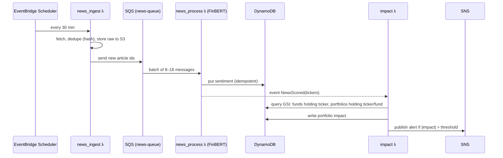

# PHASE 0 — Project Planning & Architecture

**Duration:** ~1 week · **Tier:** Mandatory · **Depends on:** nothing
**Output:** a design pack in the repo that every later phase builds against.

---

## 1. Objective

Turn the idea into decisions that are written down: scope, research universe, data sources (proven to work), data models, database design, API contract, architecture diagrams and milestones. **No production code yet**, except small throw-away "feasibility spikes" that prove the data exists.

## 2. Why it exists

Three things can kill this project, and all three are decided in Phase 0:
1. **Data you can't get** (historical Indian news, fund holdings). If you discover this in week 12, the research question collapses.
2. **Integration chaos**. The Pydantic models and API spec are the contract between the quant code, the ML code, the frontend and AWS.
3. **Scope creep**. A written MVP line lets you say "no" later.

In the viva, the Phase 0 documents become your *Methodology* and *System Design* chapters almost verbatim.

## 3. Where it sits

```text
Phase 0 (design pack) ──► Phase 1 skeleton uses folder structure + config decisions
                     ├──► Phases 2–8 implement the data models
                     ├──► Phase 13 frontend codes against the API spec
                     └──► Phases 14–17 implement the DynamoDB design + AWS diagram
```

## 4. Tools for this phase

| Tool | Why |
|---|---|
| Git + GitHub | Repo from day one; design docs are versioned like code |
| Markdown + **Mermaid** | Diagrams as text → reviewable in PRs, render on GitHub |
| draw.io (diagrams.net) | One polished AWS diagram for the report (has AWS icon set) |
| OpenAPI 3 (YAML) | Machine-readable API contract; FastAPI can be checked against it |
| Jupyter / plain Python | Data feasibility spikes |
| AWS console (5 min only) | Billing alarm + MFA. Nothing else in AWS yet. |

---

## 5. Exactly what to do, in order

### Step 1 — Decide the scope facts (Day 1, ~2 h)

Write `docs/requirements.md` with these sections. Fill in the blanks; don't over-write.

**Functional requirements (FR):**
- FR1 User can register/login (Cognito later; local stub first).
- FR2 User can create a portfolio with stocks (NSE ticker, qty, avg cost), mutual funds (scheme code, units, avg NAV) and cash.
- FR3 System values the portfolio daily and shows weights, P/L, allocation.
- FR4 System computes direct and **effective** (look-through) company and sector exposure and fund overlap.
- FR5 System computes the risk metrics list + 0–100 risk score with configurable weights.
- FR6 System ingests news, scores sentiment with FinBERT, maps to tickers/sectors, computes portfolio impact.
- FR7 System produces recommendations with reasons.
- FR8 System runs stress scenarios.
- FR9 System runs backtests and ablations and stores results.
- FR10 System sends alerts on threshold breaches.

**Non-functional requirements (NFR):**
- NFR1 Freshness: prices ≤ 1 trading day old (daily mode); news processed ≤ 30 min after ingestion. *("Near-real-time", never "real-time".)*
- NFR2 API p95 latency < 1 s for read endpoints (precomputed results).
- NFR3 Cost: < US$5–10/month in dev outside free tier. Budget alarm enforced.
- NFR4 Security: per-user isolation, no secrets in Git, least-privilege IAM.
- NFR5 Reproducibility: every backtest reproducible from a config file + data snapshot.
- NFR6 Correctness: every financial formula has a unit test against a hand-computed example.

**Out of scope:** real-money trading, HFT, Kubernetes, Kafka, RL, LLM buy/sell decisions, price-level prediction.

### Step 2 — Fix the research universe (Day 1, ~1 h)

You cannot do look-through, news coverage and backtests on "all stocks and all funds". Pick a fixed universe and write it to `config/universe.yaml`:

- **Stocks:** NIFTY 50 constituents (or top 25 by market cap if short on time). Record ticker, ISIN, sector, industry, and **aliases** for news matching (e.g. `TCS: ["Tata Consultancy Services", "TCS"]`).
- **Benchmark:** NIFTY 50 index (`^NSEI` on Yahoo), and India VIX if available.
- **Mutual funds:** 15–20 *Direct-Growth* equity schemes spread across categories so overlap is interesting: 4–5 large-cap, 3 flexi-cap, 2 mid-cap, 2 index funds (NIFTY 50), 2 sectoral (IT, Banking), 1–2 ELSS. Pick from **4–5 AMCs only** (fewer holdings-file formats to parse).
- **Cash:** risk-free proxy = 91-day T-bill yield (store as a constant per year to start).

Why sectoral IT + Banking funds: they create deliberate hidden concentration that makes your look-through demo compelling.

Survivorship bias note (write it in the doc now): picking *today's* NIFTY 50 and *today's* funds biases a 2022–2025 backtest upward. Either use the index composition as of the backtest start, or state this limitation explicitly.

### Step 3 — Data feasibility spikes (Days 2–3, most important step)

Create `spikes/` (throw-away code, not part of the app). Prove each source **before** designing around it. Record findings in `docs/data_sources.md` using this template per source:

```text
Source / endpoint / auth / params / response shape / rate limit / history depth /
India coverage / timestamp timezone / licence-terms note / verdict (use / fallback / reject)
```

Sources to test:

| # | Source | What to check |
|---|---|---|
| 1 | **yfinance** (`TCS.NS`, `^NSEI`) | 5+ years daily history, adjusted close, splits/dividends handled, missing days |
| 2 | **AMFI NAV file** (`https://www.amfiindia.com/spages/NAVAll.txt` — verify URL) | Format, scheme codes, daily publish time |
| 3 | **mfapi.in** (`https://api.mfapi.in/mf/search?q=...`, `https://api.mfapi.in/mf/{scheme_code}`) | Full NAV history per scheme, date format (dd-mm-yyyy) |
| 4 | **AMC monthly portfolio disclosures** (Excel on each AMC website) | Can you download 24–36 months? Columns: ISIN, name, % to NAV, industry |
| 5 | **Alpha Vantage NEWS_SENTIMENT** (`function=NEWS_SENTIMENT&tickers=...&time_from=YYYYMMDDTHHMM`) | Does it return articles for Indian companies? Which ticker format works? How far back? Free-tier daily limit |
| 6 | **Fallback news**: GDELT DOC API and/or publisher RSS feeds | Coverage of Indian companies, timestamps, terms of use |

Minimal spike (`spikes/check_sources.py`). It just prints evidence; keep it out of `backend/`:

```python
"""Phase 0 feasibility spike. Throw-away code: proves the data exists."""
import os
import requests
import yfinance as yf

# 1. Prices
px = yf.download(["TCS.NS", "INFY.NS", "^NSEI"], start="2019-01-01", auto_adjust=True, progress=False)
print("Prices:", px.shape, px.index.min().date(), "→", px.index.max().date())
print("Missing values per ticker:\n", px["Close"].isna().sum())

# 2. Mutual fund search + NAV history (verify endpoints in mfapi.in docs)
hits = requests.get("https://api.mfapi.in/mf/search", params={"q": "nifty 50 index direct growth"}, timeout=20).json()
print("MF search hits:", hits[:3])
if hits:
    code = hits[0]["schemeCode"]
    nav = requests.get(f"https://api.mfapi.in/mf/{code}", timeout=20).json()
    print("NAV points:", len(nav["data"]), "oldest:", nav["data"][-1], "latest:", nav["data"][0])

# 3. News coverage (key from env var — never hard-code)
key = os.environ.get("ALPHAVANTAGE_API_KEY")
if key:
    for t in ["TCS", "TCS.BSE", "INFY", "RELIANCE.BSE"]:  # find which ticker format works
        r = requests.get("https://www.alphavantage.co/query", params={
            "function": "NEWS_SENTIMENT", "tickers": t, "time_from": "20240101T0000",
            "limit": 50, "apikey": key}, timeout=30).json()
        print(t, "→", len(r.get("feed", [])), "articles", r.get("Information") or r.get("Note") or "")
```

Run with `ALPHAVANTAGE_API_KEY=xxxx python spikes/check_sources.py`. Paste the outputs into `docs/data_sources.md`. API details change; confirm every endpoint and limit against the official docs and note the date you checked.

**Decision gate at the end of Step 3:** if news coverage for Indian tickers is poor, decide *now* between (a) restricting the research universe to well-covered names, (b) adding GDELT/RSS, or (c) running the research experiment on a US universe while the app supports India. Write the decision as an ADR (`docs/adr/0001-news-source.md`).

### Step 4 — Core algorithm sketch: look-through exposure (Day 3, ~1 h)

Write `docs/algorithms/exposure.md` with the maths and a worked example you will later reuse as a unit test.

**Definitions**
- `w_i` = portfolio weight of asset *i* (stock, fund, or cash), Σ w_i = 1.
- `h_{f,s}` = weight of stock *s* inside fund *f* (from latest *published* disclosure; Σ_s h_{f,s} ≤ 1 because funds hold cash/debt).
- **Effective exposure:** `E_s = w_s^direct + Σ_f w_f · h_{f,s}`
- **Effective sector exposure:** `E_k = Σ_s E_s · 1[sector(s) = k]` + fund residual mapped to "Cash/Other".
- **Fund overlap** (pairwise): `Overlap(A,B) = Σ_s min(h_{A,s}, h_{B,s})`
- **Concentration (HHI) on effective exposures:** `HHI = Σ_s E_s²` (higher = more concentrated; `1/HHI` = "effective number of holdings").

**Worked example (becomes `test_effective_exposure`):**
Direct TCS = 20%, Fund A = 30% (TCS 8%, INFY 6%), Fund B = 20% (TCS 4%, INFY 5%).

| | Direct | via A | via B | **Effective** |
|---|---|---|---|---|
| TCS | 20.0% | 30%×8% = 2.4% | 20%×4% = 0.8% | **23.2%** |
| INFY | 0.0% | 30%×6% = 1.8% | 20%×5% = 1.0% | **2.8%** |
| IT sector (TCS+INFY only) | 20.0% | 4.2% | 1.8% | **26.0%** |

Overlap(A,B) over these two stocks = min(8,4) + min(6,5) = 4 + 5 = **9%**.

**Point-in-time rule:** holdings for month *m* are published ~10 days after month-end, so a backtest at date *t* may only use the latest disclosure whose **publish date ≤ t**.

### Step 5 — Data models (Day 4, ~2 h)

Write `docs/data_model.md` listing entities and fields (these become Pydantic models in Phase 1/3). Core entities:

```text
User(user_id, email, created_at, risk_profile, settings)
Portfolio(portfolio_id, user_id, name, base_currency="INR", created_at)
Holding(portfolio_id, asset_type{STOCK|MF|CASH}, asset_id, quantity, avg_cost, added_at)
Transaction(portfolio_id, txn_id, asset_id, type{BUY|SELL|DEPOSIT|WITHDRAW}, qty, price, ts)
Stock(ticker, isin, name, sector, industry, aliases[])
Fund(scheme_code, isin, name, amc, category, subcategory, plan{Direct|Regular},
     option{Growth|IDCW}, benchmark, expense_ratio, aum, manager, as_of)
FundHolding(scheme_code, as_of_month, published_at, isin, ticker?, name, weight, sector)
PriceBar(ticker, date, open, high, low, close, adj_close, volume, available_at)
NavPoint(scheme_code, date, nav, available_at)
NewsItem(news_id=hash(url|title), source, url, headline, summary, published_at,
         ingested_at, tickers[], sectors[], importance, reliability)
Sentiment(news_id, model="ProsusAI/finbert", p_pos, p_neu, p_neg, score=p_pos-p_neg,
          label, confidence=max(p))
RiskSnapshot(portfolio_id, as_of, metrics{...}, risk_score, risk_band, weights_config_version)
Recommendation(portfolio_id, as_of, asset_id, action, final_score, components{...},
               reasons[], constraints_triggered[], model_version)
Alert(user_id, alert_id, type, severity, message, created_at, acknowledged)
BacktestRun(run_id, config_hash, strategy, period, metrics{...}, s3_path)
```

Note the `available_at` / `published_at` fields everywhere. They are your leakage protection, designed in from day one.

### Step 6 — DynamoDB design (Day 4, ~2 h)

Rule: **design from access patterns, not from entities.** Time-series (prices, NAVs, features) go to **S3 Parquet**, not DynamoDB.

**Access patterns:**

| # | Pattern | Served by |
|---|---|---|
| AP1 | Get user profile | `UserData` PK=`USER#<sub>`, SK=`PROFILE` |
| AP2 | List a user's portfolios | `UserData` PK=`USER#<sub>`, SK begins_with `PORTFOLIO#` |
| AP3 | Get all holdings of a portfolio | `UserData` PK=`USER#<sub>`, SK begins_with `PORTFOLIO#<pid>#HOLDING#` |
| AP4 | Latest risk snapshot | SK begins_with `PORTFOLIO#<pid>#RISK#`, ScanIndexForward=false, Limit=1 |
| AP5 | Latest recommendations | SK begins_with `PORTFOLIO#<pid>#REC#<date>#` |
| AP6 | User alerts, newest first | SK begins_with `ALERT#` (timestamp in SK) |
| AP7 | Fund metadata | `MarketRef` PK=`FUND#<code>`, SK=`META` |
| AP8 | Fund holdings for a month | `MarketRef` PK=`FUND#<code>`, SK begins_with `HOLDING#<yyyy-mm>#` |
| AP9 | **Which funds hold stock X?** (news → indirect exposure) | `MarketRef` GSI1: PK=`STOCK#<ticker>`, SK=`<yyyy-mm>#FUND#<code>` |
| AP10 | **Which portfolios hold stock X or fund F?** (news → affected users) | `UserData` GSI1: PK=`ASSET#<id>`, SK=`USER#<sub>#PORTFOLIO#<pid>` (projected on holding items) |
| AP11 | Recent news for ticker X | `News` PK=`TICKER#<t>`, SK=`<published_at ISO>#<news_id>` |
| AP12 | News item by id (dedupe) | `News` PK=`NEWS#<id>`, SK=`META` + conditional put `attribute_not_exists(PK)` |

**Three tables** (a pragmatic middle ground: easier to explain in a viva than one giant single table, while still key-designed rather than normalised):
- `UserData`: everything owned by a user, all under `PK = USER#<cognito sub>`. Per-user isolation can then be enforced in code *and* explained cleanly ("every query is keyed by the JWT `sub`; a user cannot construct a key for another user").
- `MarketRef`: shared reference data (stocks, funds, fund holdings), written only by ingestion Lambdas.
- `News`: news + sentiment; TTL attribute to expire items after e.g. 180 days (raw copy stays in S3).

All tables: **on-demand capacity** (no idle cost), point-in-time recovery off in dev (cost), TTL where useful.

### Step 7 — API specification (Day 5, ~2 h)

Write `docs/api/openapi.yaml` (start with paths + example responses; it can be refined later). Conventions: JSON, ISO-8601 UTC timestamps, amounts in INR as decimals, weights as fractions (0.232 not 23.2), errors as `{ "error": { "code", "message" } }`, all `/portfolio*` routes require `Authorization: Bearer <JWT>`.

| Method | Path | Purpose |
|---|---|---|
| GET | `/health` | Liveness (no auth) |
| POST | `/portfolio` | Create portfolio with holdings |
| GET | `/portfolio` | List my portfolios |
| GET | `/portfolio/{id}` | Valuation, weights, P/L |
| PUT | `/portfolio/{id}/holdings` | Replace holdings |
| GET | `/portfolio/{id}/exposure` | Direct vs effective company/sector exposure, overlap |
| GET | `/portfolio/{id}/risk` | Risk metrics + score |
| POST | `/portfolio/{id}/stress` | Run a scenario |
| GET | `/portfolio/{id}/news` | Relevant news + portfolio impact |
| GET | `/portfolio/{id}/recommendations` | Actions + reasons |
| GET | `/stocks/{ticker}` | Stock analytics |
| GET | `/mutual-funds/{scheme_code}` | Fund analytics + holdings |
| POST | `/backtest` | Start a backtest (async → returns `run_id`) |
| GET | `/backtest/{run_id}` | Status + results |

Example contract (`GET /portfolio/{id}/exposure`):

```json
{
  "portfolio_id": "p_01",
  "as_of": "2026-10-03",
  "holdings_as_of": { "FUND#A": "2026-08", "FUND#B": "2026-08" },
  "companies": [
    { "ticker": "TCS", "direct": 0.200, "indirect": 0.032, "effective": 0.232,
      "via": [ { "fund": "A", "contribution": 0.024 }, { "fund": "B", "contribution": 0.008 } ] }
  ],
  "sectors": [ { "sector": "IT", "direct": 0.20, "effective": 0.26 } ],
  "overlap": [ { "fund_a": "A", "fund_b": "B", "overlap": 0.09 } ],
  "hhi_effective": 0.071
}
```

### Step 8 — Diagrams (Day 5–6, ~3 h)

Put Mermaid sources in `docs/diagrams/` and one polished draw.io export (PNG + `.drawio`) for the report:
1. **System architecture (AWS)**: copy the layered diagram from `00_PROJECT_PLAN.md` §3 into draw.io with AWS icons.
2. **Component diagram**: the domain modules and their dependencies (risk depends on market + exposure, etc.).
3. **Data-flow diagram (Level 0 and Level 1)**: user ↔ system; then ingestion → processing → storage → API.
4. **News → portfolio impact sequence diagram**: EventBridge → ingest λ → SQS → FinBERT λ → impact λ → DynamoDB → SNS.
5. **ER/access-pattern diagram** for DynamoDB.

Starter Mermaid (sequence):



### Step 9 — Repo + AWS safety (Day 6, ~1 h)

1. Create GitHub repo `portfolio-intelligence` (private while in progress). Add `.gitignore` (Python, Node, Terraform, `.env`), `LICENSE`, `README.md` (title, disclaimer, one-paragraph description, link to docs).
2. Protect `main`: require PRs. Work on branches like `phase-0/design-docs`.
3. Create the folder skeleton (empty dirs with `.gitkeep`):

```text
portfolio-intelligence/
├── backend/app/{api,services,models,analytics,utils}/   backend/tests/
├── backend/app/analytics/mutual_fund_engine/
├── data/{raw,processed,historical}/      # gitignored except .gitkeep
├── models/  notebooks/  frontend/  infrastructure/{modules,environments/{dev,prod}}/
├── lambda/  scripts/  docker/  spikes/  config/
└── docs/{adr,algorithms,api,diagrams}/   docs/00_PROJECT_PLAN.md  docs/01_PHASE_0_GUIDE.md
```

4. **AWS (only this, nothing else yet):** enable MFA on root, create an admin IAM user/Identity Center user for yourself, and create an **AWS Budget of US$5 with email alerts at 50/80/100%**. That costs nothing and protects you from surprise bills later.
5. Register a free Alpha Vantage key; store it only in a local `.env` (gitignored) for now.

### Step 10 — Milestones (Day 7, ~30 min)

Create GitHub Milestones = phases, and Issues = tasks from the phase table. Use a GitHub Project board (Todo / Doing / Done). This doubles as evidence of process in the viva.

---

## 6. Validation: how you know Phase 0 is done well

- Someone else (friend, guide) can read `requirements.md` + `data_model.md` + `openapi.yaml` and explain what the system does without you.
- Every data source has a **verdict** backed by spike output, not assumptions.
- The exposure worked example sums correctly (23.2%, 2.8%, 26.0%, 9%).
- Every DynamoDB access pattern AP1–AP12 maps to a key/GSI; none needs a Scan.
- Every API endpoint maps to at least one FR.
- AWS budget alarm email received (AWS sends a confirmation).

## 7. Git commits

```text
docs: add project plan and phase 0 guide
docs: add requirements, research universe and data source evaluation
docs(adr): 0001 choose news source after feasibility spike
docs: add data model, DynamoDB access patterns and OpenAPI draft
docs: add architecture, component, data-flow and sequence diagrams
chore: scaffold repository structure
```

## 8. Phase 0 checklist

- [ ] `docs/requirements.md` (FR, NFR, out-of-scope, disclaimer)
- [ ] `config/universe.yaml` (stocks + aliases, 15–20 funds, benchmark, risk-free proxy)
- [ ] Spike run for all 6 data sources; `docs/data_sources.md` filled with verdicts
- [ ] ADR 0001 news source decision
- [ ] `docs/algorithms/exposure.md` with worked example
- [ ] `docs/data_model.md` with `available_at` fields
- [ ] DynamoDB access patterns + 3-table key design
- [ ] `docs/api/openapi.yaml` draft
- [ ] 5 diagrams (Mermaid) + 1 polished AWS diagram (draw.io)
- [ ] GitHub repo, branch protection, folder skeleton, milestones/issues
- [ ] AWS root MFA + US$5 budget alarm
- [ ] Alpha Vantage key in local `.env` only
- [ ] **News collector idea noted for Week 2** (start archiving news ASAP)

When this list is ticked, move to **Phase 1 — Foundation**.
