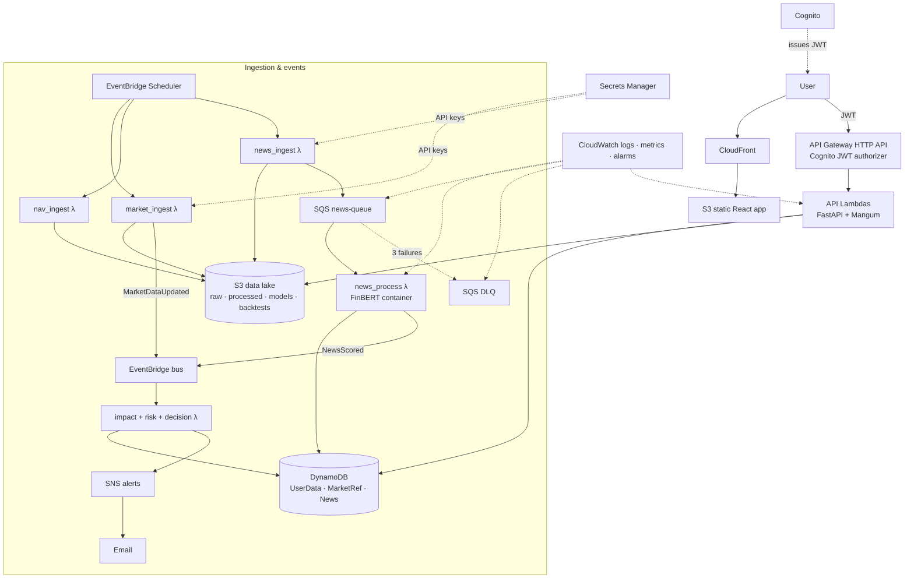
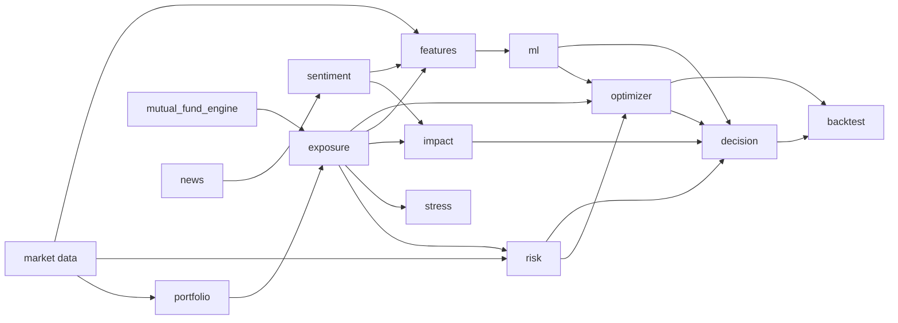
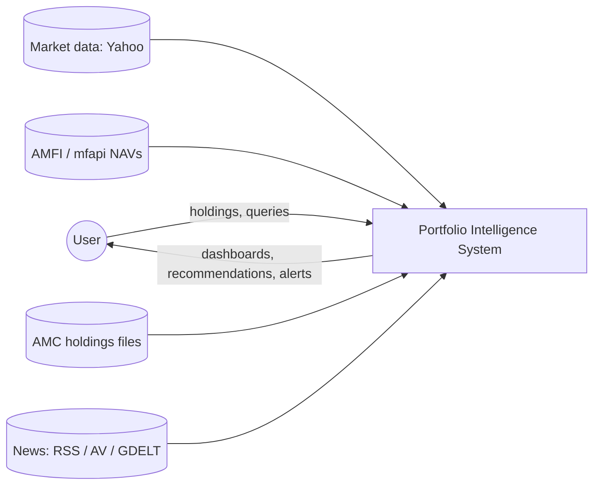
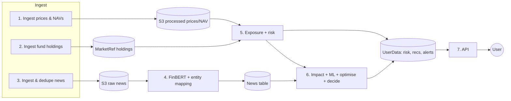
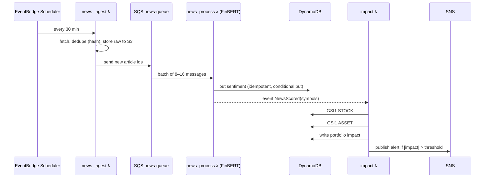

# Diagrams (Mermaid; renders on GitHub)

For the report, redraw diagram 1 in draw.io with the AWS icon set and save it as `aws_architecture.drawio` + `.png`.

## 1. System architecture (AWS)


## 2. Component diagram (domain core, AWS-independent)


## 3a. Data-flow diagram, level 0


## 3b. Data-flow diagram, level 1


## 4. News → portfolio impact sequence


## 5. DynamoDB key design
```mermaid
erDiagram
  UserData {
    string PK "USER#sub"
    string SK "PROFILE | PORTFOLIO#pid#META | PORTFOLIO#pid#HOLDING#type#id | PORTFOLIO#pid#RISK#ts | PORTFOLIO#pid#REC#date#asset | ALERT#ts#id"
    string GSI1PK "ASSET#type#id (holdings only)"
    string GSI1SK "USER#sub#PORTFOLIO#pid"
  }
  MarketRef {
    string PK "STOCK#symbol | FUND#code"
    string SK "META | HOLDING#yyyy-mm#isin"
    string GSI1PK "STOCK#symbol (holding rows)"
    string GSI1SK "yyyy-mm#FUND#code"
  }
  News {
    string PK "NEWS#id | TICKER#symbol"
    string SK "META | published_at#id"
    number ttl "expire after 180 days"
  }
  UserData ||--o{ MarketRef : "holding asset_id → fund/stock"
  MarketRef ||--o{ News : "symbol → articles"
```
